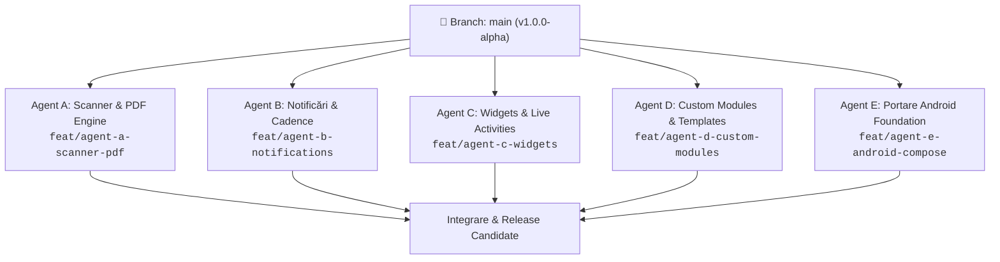

# 🚀 Plan de Dezvoltare Multi-Agent — Dosar cu Șină

> **Obiectiv**: Scalarea și finalizarea aplicației *Dosar cu Șină* prin divizarea muncii în 5 fluxuri de lucru paralele, complet decuplate, asignate unor agenți autonomi specializați. Fără suprapuneri de fișiere, fără conflicte Git, cu contracte de date clare și criterii riguroase de acceptanță (DoD).

---

## 1. Arhitectura de Decuplare & Prevenirea Conflictelor Git

Pentru ca agenții să poată lucra în paralel fără blocaje sau merge conflicts:
1. **Zero Conflicte pe Proiectul Xcode**: Folosim `PBXFileSystemSynchronizedRootGroup` (feature nativ Xcode 16/27). Orice fișier `.swift` creat într-un subdirector este indexat automat de Xcode **fără să fie nevoie de modificarea `project.pbxproj`**.
2. **Proprietate Exclusivă pe Directoare**: Fiecare agent deține exclusiv fișierele din modulul său.
3. **Contracte de Date Imutabile**: Modelele SwiftData existente (`Asset`, `LifecycleEvent`, `DocumentAttachment`, `DynamicField`) servesc drept contract de bază. Orice extensie se face prin fișiere `+Extensions.swift` locale modulului respectiv.
4. **Politica de Ramificare (Branching)**:
   - Fiecare agent lucrează pe un branch dedicat: `feat/agent-<id>-<scop>`.
   - Toate commit-urile respectă standardul Conventional Commits (`feat:`, `fix:`, `docs:`, `test:`).

---

## 2. Matricea de Asignare a Agenților

| Agent / Flux | Rol Cheie | Directoare & Fișiere Alocate Exclusiv | Dependențe Externe |
| :--- | :--- | :--- | :--- |
| **Agent A** | *Scanner & PDF Engine* | `ios/DosarCuSina/Services/PDF/` `ios/DosarCuSina/Services/OCR/` `ios/DosarCuSina/Views/Scanner/LiveCamera/` | `VisionKit`, `PDFKit` |
| **Agent B** | *Notifications & Life Cadence* | `ios/DosarCuSina/Services/Notifications/` `ios/DosarCuSina/Services/Cadence/` `ios/DosarCuSina/Intents/` | `UserNotifications`, `AppIntents` |
| **Agent C** | *Widgets & Apple Polish* | `ios/DosarCuSinaWidgets/` `ios/DosarCuSina/Resources/Assets.xcassets/` | `WidgetKit`, `ActivityKit` |
| **Agent D** | *Custom Modules & Templates* | `ios/DosarCuSina/Views/CustomModules/` `shared/templates/` | `SwiftData`, `SwiftUI` |
| **Agent E** | *Android Compose Foundation* | `android/` (arhitectură completă Room + Jetpack Compose) | `Android SDK`, `Compose` |

---

## 3. Specificațiile Detaliate ale Fiecărui Pachet de Lucru

### 🤖 Agent A: Scanner Live & PDF Dossier Export Engine
* **Obiectiv**: Ducerea scanării și exportului de documente la nivel de producție.
* **Fișiere de Creat**:
  1. `ios/DosarCuSina/Views/Scanner/LiveCamera/LiveDocumentScannerView.swift`: Controller `VNDocumentCameraViewController` nativ pentru scanare multipagină cu corecție de perspectivă automată și haptics.
  2. `ios/DosarCuSina/Services/OCR/RomanianUtilityParser.swift`: Extensie de parsare inteligentă regex pentru furnizori din România (Digi, PPC/Enel, Hidroelectrica, E.ON, Engie, Vodafone, Orange) — detectează automat codul de client, indexul autocitit și codul de bare/QR de plată.
  3. `ios/DosarCuSina/Services/PDF/PDFDossierGenerator.swift`: Generator `PDFKit` care produce un „Dosar Complet” elegant (layout stil Apple, tipografie SF Pro, logo-uri active, tabele cu istoric de intervenții, costuri totale și facturi atașate în anexă).
* **Definition of Done (DoD)**:
  - Scanarea multipagină produce PDF-uri optimizate (compresie eficientă).
  - Exportul dosarului generează un fișier PDF gata de partajare prin `ShareLink`.
  - Zero erori de compilare (`swiftc -parse`).

---

### 🤖 Agent B: Motorul de Notificări, Recurențe & App Intents
* **Obiectiv**: Asigurarea alertelor la timp și integrarea cu Siri/Shortcuts.
* **Fișiere de Creat**:
  1. `ios/DosarCuSina/Services/Notifications/NotificationScheduler.swift`: Gestionare notificări locale `UNUserNotificationCenter` cu categorii personalizate și acțiuni interactive direct din banner (*„Am rezolvat”* și *„Amână 3 zile”*).
  2. `ios/DosarCuSina/Services/Cadence/CadenceCalculator.swift`: Motor matematic pentru calculul scadențelor:
     - Recurențe calendaristice (zile, luni, ani cu tratare an bisect).
     - Recurențe pe bază de telemetrie (estimare dată pe baza ritmului mediu de km/zi parcurși).
  3. `ios/DosarCuSina/Intents/DosarIntents.swift`: Adopție `AppIntents` (iOS 17+) pentru Siri și Shortcuts:
     - *"Ce îmi expiră luna asta?"*
     - *"Când expiră ITP-ul la mașină?"*
* **Definition of Done (DoD)**:
  - Notificările sunt programate cu offset-uri automate (-30z, -7z, -1z, zi scadență).
  - Siri Shortcuts returnează răspunsuri concise în limba română.

---

### 🤖 Agent C: Widget-uri Interactive & Apple Polish
* **Obiectiv**: Vizibilitate instantanee pe Lock Screen și Home Screen conform ghidului Apple Human Interface.
* **Fișiere de Creat**:
  1. `ios/DosarCuSinaWidgets/DosarCuSinaWidgets.swift`:
     - **Lock Screen Circular Widget**: Pictogramă activ + număr de zile rămase până la cea mai apropiată scadență.
     - **Home Screen Medium Widget**: Radar cu următoarele 3 scadențe și buton interactiv de bifare directă (`Button(intent:)`).
  2. `ios/DosarCuSinaWidgets/WidgetDataProvider.swift`: Provider `TimelineProvider` care citește datele din SwiftData/AppGroup.
  3. `ios/DosarCuSina/Resources/Assets.xcassets/`: Structura completă de asset-uri (AppIcon squircle continuu, culori semantice de sistem).
* **Definition of Done (DoD)**:
  - Widget-urile se actualizează automat la modificarea datelor.
  - Geometrie concentrică respectată ($R_{\text{interior}} = R_{\text{exterior}} - \text{padding}$).

---

### 🤖 Agent D: Custom Modules Engine UI & Starter Templates
* **Obiectiv**: Interfața dedicată pentru crearea oricărui tip de modul și galeria de șabloane.
* **Fișiere de Creat**:
  1. `ios/DosarCuSina/Views/CustomModules/CustomModuleBuilderView.swift`: Ecran fluid pentru asamblarea unui modul nou (selector SF Symbols căutabil, paletă de culori Apple, alegerea tipului de declanșator: timp, kilometri, ore sau cicluri).
  2. `ios/DosarCuSina/Views/CustomModules/StarterTemplatesGalleryView.swift`: Galerie tactilă cu carduri preview pentru șabloanele comunitare (Bicicletă/E-Bike, Plante, Proprietăți Închiriate, Espressor, Ambarcațiuni).
  3. `ios/DosarCuSina/Views/CustomModules/DynamicFieldEditorView.swift`: Formular dinamic pentru adăugarea de atribute custom la active.
* **Definition of Done (DoD)**:
  - Utilizatorul poate importa un șablon cu 1 singur tap.
  - Modulul nou creat apare imediat în lista din tab-ul „Active”.

---

### 🤖 Agent E: Portare Android Foundation (Kotlin + Jetpack Compose)
* **Obiectiv**: Scheletul nativ Android pregătit pentru distribuție pe Google Play.
* **Fișiere de Creat**:
  1. `android/app/build.gradle.kts` & `android/build.gradle.kts`: Configurare Gradle modernă cu Kotlin 2.0, Compose BOM, Room, Hilt/Koin și Navigation.
  2. `android/app/src/main/java/com/dosarcusina/data/`:
     - `AssetEntity.kt`, `LifecycleEventEntity.kt`, `AttachmentEntity.kt` (Room SQLite, identice cu schema SwiftData).
     - `DosarDatabase.kt` & DAO-uri.
  3. `android/app/src/main/java/com/dosarcusina/ui/`:
     - `RadarScreen.kt` & `VaultScreen.kt` construite cu Jetpack Compose și Material 3 Expressive.
  4. `android/app/src/main/java/com/dosarcusina/ocr/`:
     - Scaner CameraX + Google ML Kit Text Recognition (offline, gratuit).
* **Definition of Done (DoD)**:
  - Proiectul Android este funcțional, compilează curat și are paritate de date 1:1 cu versiunea iOS.

---

## 4. Protocolul de Execuție & Validare

1. **Pasul 1 (Lansare Agenți)**: Fiecare agent este instanțiat cu scopul său unic și lucrează strict în directorul alocat.
2. **Pasul 2 (Verificare Tehnică Locală)**:
   - Pentru agenții iOS: validare automată cu `swiftc -parse $(find <director_agent> -name "*.swift")`.
   - Verificare securitate: niciun fișier atins din `private/`, niciun secret în cod.
3. **Pasul 3 (Commit & Reconciliere)**:
   - Fiecare agent livrează un commit atomic formatat convențional (ex: `feat(scanner): implement VNDocumentCameraViewController live capture`).
   - Sincronizare finală în `SPEC.md` și `README.md`.
