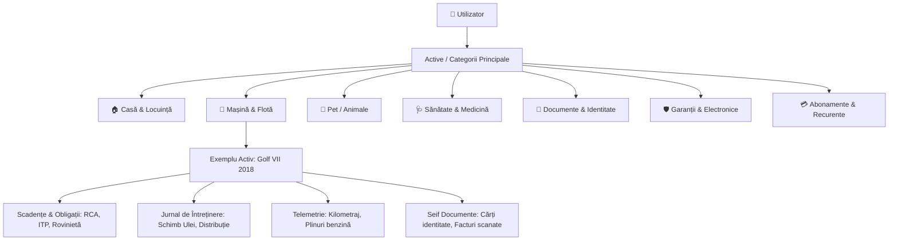
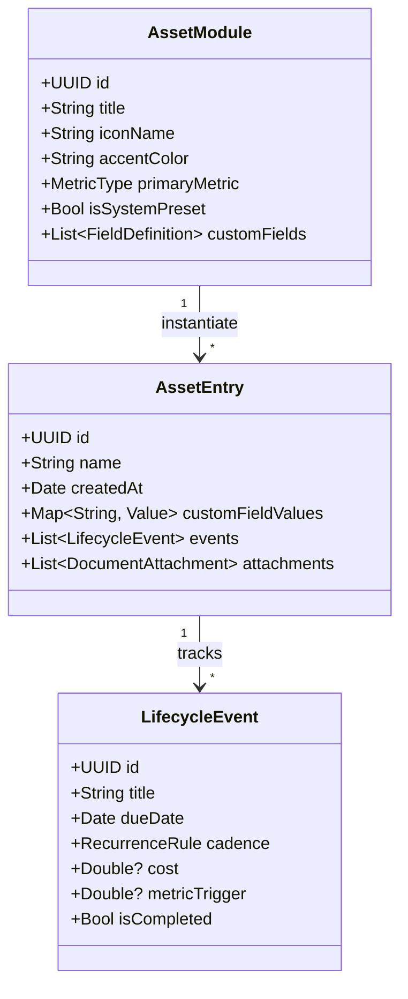
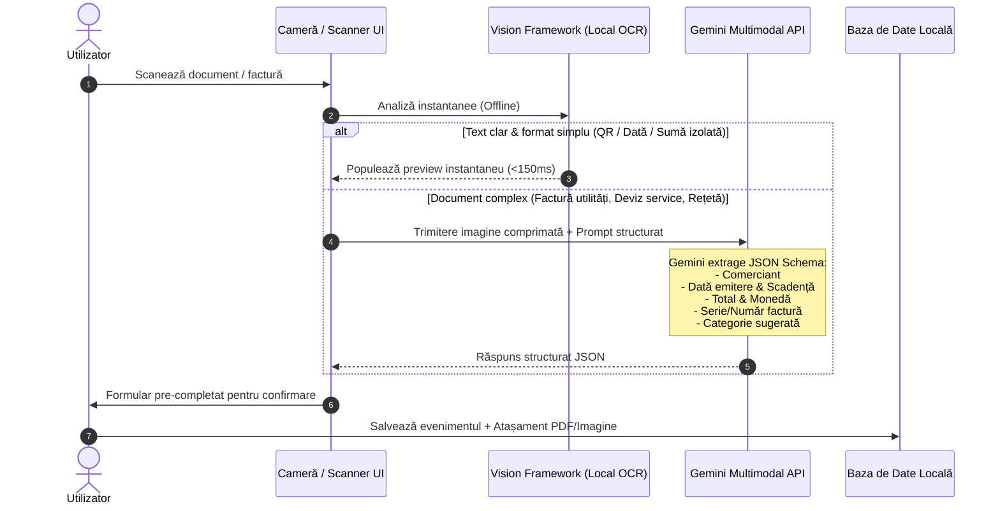

# 📁 Dosar cu Șină — Product Specification

> **Misiune**: Transformarea birocrației personale și a "treburilor casnice invizibile" dintr-o sursă constantă de fricțiune mentală într-o experiență digitală demnă de standardele Apple: discretă, fluidă, predictivă și impecabil structurată.

---

## 1. Viziunea Produsului & Problema Rezolvată

### 1.1 De ce eșuează un calendar generic?
Un calendar clasic (Google Calendar, Apple Calendar) este **orientat pe sloturi de timp**, nu pe **active (assets)**:
- **Lipsa contextului istoric**: Îți amintește că ai "Service la mașină pe 15 mai", dar nu știe câți kilometri aveai la revizia anterioară, ce tip de ulei s-a folosit sau cât te-a costat în total mașina anul trecut.
- **Lipsa relațiilor ierarhice**: Nu poți grupa evenimentele pe "Active" (Mașina X, Apartamentul Y, Cățelul Z) și nici asocia documente (polițe, garanții, bonuri fiscale) într-un mod consultabil la cerere.
- **Lipsa logicii de domeniu**: Calendarul nu știe că un ITP la mașini mai vechi de 12 ani se face anual, iar la cele noi la 2 sau 3 ani; nu știe că deparazitarea internă la câini este trimestrială sau că VTP-ul la centrala termică este obligatoriu la 2 ani.

### 1.2 Modelul Mental: *Asset-Centric Life Admin*
*Dosar cu Șină* inversează paradigma:
1. **Entitate / Activ (Asset)**: Un obiect fizic, un membru al familiei sau un spațiu pe care îl administrezi.
2. **Ciclu de Viață & Recurențe**: Reguli specifice domeniului (timp sau metrici: km, ore de funcționare).
3. **Evenimente & Jurnal**: Log-uri punctuale cu costuri, note, fotografii și documente atașate.
4. **Dosar Exportabil**: Posibilitatea de a extrage oricând un PDF complet (ex: istoricul mașinii pentru revânzare sau istoricul medical la medicul veterinar).



---

## 2. Categoriile Aplicației (Secțiuni de Bază + Extensii)

### 2.1 🏠 1. Casă & Locuință
*Focus: Siguranță tehnică, conformitate legală și mentenanță preventivă.*

| Componentă | Tip / Recurență uzuală | Câmpuri specifice | Atașamente tipice |
| :--- | :--- | :--- | :--- |
| **VTP Centrală Termică** | La 2 ani (obligatoriu ISCIR) | Tehnician/Firmă autorizată, Seria centralei, Notă constatări | Raport de verificare tehnică |
| **Verificare / Revizie Gaze** | Verificare: 2 ani / Revizie: 10 ani | Notă tehnică, Detector gaz funcțional (Da/Nu) | Proces verbal semnat |
| **Asigurări Locuință** | Anual | PAD (obligatoriu) vs Facultativă, Sumă asigurată, Franșiză | Polița PDF, Chitanță |
| **Impozit Local (Taxe)** | 31 Martie (bonificație) / 30 Sept | Cont rol fiscal, Sumă datorată | Dovadă plată Ghișeul.ro |
| **Filtre & Climatizare** | Sezonier (3-6 luni) | Tip filtru (dimensiuni/cod), Dată igienizare AC | Factură consumabile |
| **Curățare Coș Fum / Șemineu** | Anual (toamna) | Coșar autorizat, data inspecției | Adeverință coșerit |
| **Filtre Apă / Dedurizator** | 3 - 6 luni / pe bază de volum | Schimb sare, cartușe carbon/sedimente | — |
| **Contoare & Index** | Lunar (ziua 20-25) | Apă caldă/rece, Gaz, Curent, Serie contor | Poză index pentru siguranță |

---

### 2.2 🚗 2. Mașină & Mobilitate
*Focus: Legalitate rutieră, siguranță la drum, telemetrie și controlul costului total de deținere (TCO).*

| Componentă | Tip / Condiție | Câmpuri specifice | Alertă inteligentă |
| :--- | :--- | :--- | :--- |
| **ITP (Inspecție Tehnică)** | 1 an (>12 ani) / 2 ani / 3 ani (nouă) | Stație ITP, Kilometraj la testare | -30 zile, -7 zile, -1 zi |
| **RCA & CASCO** | 1, 6 sau 12 luni | Asigurător, Decontare directă, Clasă Bonus-Malus | -30 zile (pentru ofertare) |
| **Rovinietă & Taxe Drum** | 1 zi / 10 zile / 30 zile / 1 an | Serie șasiu (VIN), Categorie vehicul, Țară | Expirare la oră fixă |
| **Revizie Periodicǎ** | 1 an SAU 10.000–15.000 km | Ulei, filtru aer/ulei/polen/motorină, Lichid frână | Se declanșează la timp sau km |
| **Schimb Anvelope** | Sezonier (Noiembrie / Aprilie) | Adâncime profil (mm), Loc depozitare (hotel roți) | Temperatură sub 7°C (sugestie) |
| **Jurnal Kilometraj & Plin** | Eveniment | Odometru curent, Litri/kWh, Preț/unitate, Locație | Calculează automat consum/100km |
| **Trusă Medicală & Stingător** | 2 - 5 ani (termen omologare) | Data expirării de pe ambalaj | Evită amenzi de circulație |

---

### 2.3 🐾 3. Pet / Animale de Companie
*Focus: Sănătate preventivă, confort veterinar și documente internaționale de călătorie.*

| Componentă | Tip / Recurență | Câmpuri specifice | Notițe / Context |
| :--- | :--- | :--- | :--- |
| **Deparazitare Internă** | Trimestrial (la 3 luni) | Greutate curentă (dozaj pastilă), Nume produs | Esențial înainte de vaccinare |
| **Deparazitare Externă** | Lunar (pipetă) sau la 6-8 luni (zgură) | Tip paraziți vizați (căpușe, purici, flebotomi) | Alertă de reaplicare |
| **Vaccin Anual Polivalent** | Anual (DHPPi/Lepto/Tricat) | Serie lot vaccin, Ștampilă veterinar | Istoric în carnetul de sănătate |
| **Vaccin Antirabic** | Anual (obligatoriu legal) | Număr pașaport/carnet, Microcip (15 cifre) | Necesar la trecerea frontierei |
| **Greutate & Dietă** | Lunar / Trimestrial | Grafic evoluție greutate (kg), Porție zilnică (g) | Monitorizare obezitate/slăbire |
| **Toaletaj (Grooming)** | 4 - 8 săptămâni | Tăiere unghii, Golire glande, Curățare urechi | Contact salon / Notă comportament |

---

### 2.4 🩺 4. Sănătate Personală & Medicină Preventivă *(Extins)*
*Focus: „Mentenanța propriului corp” — transformarea analizelor și a prevenției dintr-o reacție la boală într-un plan proactiv organizat.*

| Sub-domeniu | Tip / Recurență | Câmpuri specifice & Parametri | Documente / Atașamente |
| :--- | :--- | :--- | :--- |
| **Screening & Analize Anuale** | Anual (sau la recomandarea medicului) | Set uzual (hemogramă, profil lipidic, glicemie, funcție renală/hepatică, TSH) | Buletin de analize PDF (OCR extrage valori anormale cu `*`) |
| **Stomatologie & Profilaxie** | La 6 luni | Igienizare profesională, detartraj, control carii, medic curant | Radiografie panoramică (OPG) |
| **Dermatoscopie (Harta Alunițelor)** | Anual (pre/post sezon estival) | Număr leziuni suspecte monitorizate, fotografii macro comparative | Raport dermatoscopic |
| **Oftalmologie / Optometrie** | La 1 - 2 ani | Dioptrii (OD/OS), cilindru, axă, tensiune intraoculară | Rețetă ochelari/lentile |
| **Cardiologie & Screening Vârstă** | 1 - 2 ani (>40 ani) | EKG de repaus, ecocardiografie, tensiune arterială medie | Traseu EKG, Raport eco |
| **Screening Oncologic Specific** | Periodic conform ghidurilor | Femei: Babeș-Papanicolau/HPV (1-3 ani), Ecografie/Mamografie (1-2 ani). Bărbați: PSA (>45-50 ani). General: Colonoscopie (la 5-10 ani >45 ani). | Rezultate biopsie / imagistică |
| **Carnet Vaccinuri Adult** | 10 ani / Anual | **Antitetanos (DT)** (rapel esențial la fiecare 10 ani!), Gripal sezonier (anual), Hepatită B, etc. | Adeverință vaccinare |
| **Intervenții & „Pașaport Medical”** | Eveniment / Permanent | Tip intervenție, Medic chirurg, Clinică, **Pașaport implant** (lot, serie șurub stomatologic/proteză) | Scrisoare medicală, Bilet externare |
| **Tratamente & Rețete Cronice** | Lunar / Trimestrial | Denumire DCI, Dozaj (mg/zi), Alertă expirare rețetă compensată | Rețetă electronică scanată |

---

### 2.5 🪪 5. Documente Personale & Identitate
*Focus: Alertare timpurie pentru a evita blocaje birocratice și cozi.*

- **Carte de Identitate (Buletin)**: Alertă cu 3–6 luni înainte (programările la evidența populației durează adesea săptămâni).
- **Pașaport**: Valabilitate 5 sau 10 ani. *Alertă inteligentă*: atenționează dacă pașaportul are sub 6 luni de valabilitate rămasă (majoritatea țărilor non-UE refuză intrarea în aceste condiții).
- **Permis de Conducere**: Scadență la 10 ani (cu reminder pentru programare fișă medicală).
- **Carduri Bancare**: Lună/An expirare pe cardurile de debit/credit (reminder pentru primirea noului card).
- **Semnătură Electronică Calificată**: Reînnoire certificat digital (token CertSign, DigiSign etc. la 1, 2 sau 3 ani).
- **Cazier Judiciar / Certificate Fiscale**: Documente cu valabilitate scurtă (30–180 zile).

---

### 2.6 🛡️ 6. Garanții & Bunuri Electrocasnice *(Secțiune Propusă)*
*Focus: Protecția investițiilor, eliminarea dosarului de hârtie cu bonuri termice șterse.*

- **Stocare Bon Fiscal + Certificat**: Bonurile termice se estompează în 6–12 luni; scanarea digitală securizează dreptul la garanție.
- **Calculatoare & Telefoane**: AppleCare / Garanție producător (1 sau 2 ani).
- **Electrocasnice Mari (Frigider, Mașină de spălat, TV)**: Garanție extinsă la înregistrarea produsului (ex: 5 ani garanție promoțională).
- **"Alertă Ultima Șansă"**: Cu 30 de zile înainte de expirarea garanției de 2 ani, utilizatorul primește o notificare: *"Verifică dispozitivul — mai ai o lună de garanție activă pentru eventuale reparații gratuite."*
- **Manual de Utilizare**: Câmp pentru link descărcare manual PDF sau atașament direct.

---

### 2.7 💳 7. Abonamente & Perioade de Testare (Trials) *(Secțiune Propusă)*
*Focus: Stoparea "taxelor pe uitare".*

- **Perioade de Free Trial**: Alertă cu 48 de ore înainte de conversia într-un abonament plătit (sală, servicii streaming, unelte software).
- **Abonamente Anuale**: Notificare cu 14 zile înainte de debitarea automată pentru a decide dacă merită păstrat.
- **Cost Lunar Consolidat**: Calcul total agregat: "Plătești 340 lei/lună pe abonamente digitale".

---

### 2.8 🧩 8. Motorul de Module Personalizate (Custom Modules Engine)
*Focus: Libertate totală de configurare fără senzația de spreadsheet complicat.*

Fiecare utilizator are pasiuni și active unice: o bicicletă de șosea, o barcă cu motor, plante exotice, un espressor manual de cafea sau un apartament dat în chirie. În loc să aglomerăm aplicația cu zeci de categorii de nișă fixe, *Dosar cu Șină* include un **arhitect de module personalizate** (cu ergonomie specifică Apple).



#### 2.8.1 Tipuri de Câmpuri Componibile (Field Types)
Când utilizatorul creează un modul propriu (ex: *„Ambarcațiune”* sau *„Bicicletă”*), poate asocia:
1. **Recurență Calendaristică**: Zile, Săptămâni, Luni, Ani (cu alertă inteligentă înainte de termen).
2. **Declanșator pe Bază de Metrice (Unit Triggers)**:
   - *Kilometri* (ex: Schimb lanț bicicletă la fiecare 2.000 km).
   - *Ore de funcționare* (ex: Service furcă suspensie la 50 de ore; Schimb ulei cizmă motor barcă la 100 de ore).
   - *Contor de cicluri* (ex: Decalcifiere espressor la fiecare 250 de cești preparate).
3. **Câmpuri Monetare (Financial / Cost Tracker)**: Cu selectare automată a monedei (RON, EUR, USD) pentru includerea în graficele TCO.
4. **Seif Atașamente (Document / Foto / Bon)**: Câmp dedicat pentru fotografii ale etichetelor tehnice, facturi sau PDF-uri.
5. **Contact Asociat**: Legătură directă cu un contact din agendă (Mecanic, Medic, Tehnician, Chiriaș).

#### 2.8.2 Galeria de Șabloane Predefinite (Starter Templates)
Pentru a elimina teama de „pagină albă” (blank slate), utilizatorul poate alege din șabloane comunitare gata configurate cu 1 tap:
* 🚴 **Bicicletă / E-Bike**: Ungere lanț (la 150 km), Verificare plăcuțe (la 1.000 km), Înlocuire lanț (la 2.000 km), Service furcă (la 50h/100h).
* 🪴 **Plante & Grădină**: Udare periodică, Fertilizare fazială sezonieră (primăvară/toamnă), Tăiere de formare, Schimbare ghiveci/substrat (la 2 ani).
* 🏢 **Proprietăți Închiriate (Landlord Hub)**: Scadență plată chirie, Reînnoire contract ANAF, Verificare apometre chiriaș, Restituire/decont garanție.
* ☕ **Cafea de Specialitate & Echipamente**: Decalcifiere periodică, Curățare chimică grup (Cafiza), Înlocuire filtru apă/rășină dedurizatoare.
* 📸 **Echipament Foto / Video**: Curățare senzor, Verificare calibrare obiective, Asigurare echipament profesional.

---

## 3. Sistemul Inteligent de Scanare (Two-Tier Hybrid OCR)

Abordarea propusă este **Dual-Tier**, îmbinând viteza și confidențialitatea scanării locale cu puterea de raționament a inteligenței artificiale multimodale.



### 3.1 Nivelul 1: Scanare On-Device (Apple Vision / MLKit)
- **Ce face**: Rulează 100% offline, fără conexiune la internet, cu latență infimă.
- **Detectare automată a marginilor**: Decupare perspectivă automată, corecție unghi, conversie alb-negru/document scanat.
- **Detecție de modele regex**:
  - Date calendaristice (formate românești: `DD.MM.YYYY`, `DD/MM/YYYY`, `DD luna YYYY`).
  - Coduri QR de plată (standardizate conform formatelor bancare/Ghișeul).
  - Sume monetare (căutare după cuvinte cheie: "Total", "De plată", "Rest de plată", "RON", "LEI").

### 3.2 Nivelul 2: Semantic Sweep prin Gemini Flash
- **Când se activează**: La cererea utilizatorului (buton dedicat "Analizează cu AI") sau automat pe facturi complexe cu mai multe pagini.
- **Format ieșire (Structured JSON Schema)**:
```json
{
  "merchant": "ENGIE Romania S.A.",
  "document_type": "utility_invoice",
  "category_suggestion": "casa_energie_gaz",
  "issue_date": "2026-10-15",
  "due_date": "2026-11-14",
  "total_amount": 348.50,
  "currency": "RON",
  "invoice_number": "1049281928",
  "extracted_notes": "Index autocitit vechi: 1420 mc, Index nou: 1495 mc",
  "actionable_reminder_date": "2026-11-10"
}
```
- **Confidențialitate & Securitate**: Nu se stochează datele pe servere externe; procesarea se face efemer prin API cu cheie proprie direct către Google.

---

### 3.3 Modelul de Distribuție & BYOK (App Store Review Compliant)
Aplicația este proiectată să fie publicată **100% Free** în App Store, respectând riguros *Apple App Store Review Guidelines (Guideline 2.1 - App Completeness & Guideline 3.1.1)*:
1. **Valoare Core Completă (Fără Cheie API)**:
   - Aplicația **nu este o carcasă goală**. Utilizatorul fără cheie API are acces nelimitat la gestionarea activelor, calendarul scadențelor, notificările locale, widget-urile de ecran, graficele TCO și **scanarea locală de documente prin Apple Vision**.
2. **Deblocare AI prin BYOK (Bring Your Own Key)**:
   - Oricine dorește scanare avansată și clasificare semantică a facturilor complexe își poate adăuga o cheie gratuită Gemini (obținută cu 1 tap de pe Google AI Studio).
   - Cheia este stocată exclusiv pe dispozitiv în **iOS Keychain** criptat.
3. **Sustenabilitate & Cost 0$ pentru Dezvoltator**:
   - Zero servere de administrat, zero facturi lunare de cloud, zero baze de date vulnerabile. Scalare instantanee la orice volum de utilizatori.

---

## 4. Statistici, Rapoarte & "Financial Pulse"

Unul dintre marile diferențiatori față de un simplu to-do list este transformarea datelor introduse în **concluzii financiare și operaționale utile**:

1. **Cost of Ownership (TCO) pe Categorii**:
   - *Mașină*: Cât mă costă mașina pe an defalcat pe: Combustibil, Asigurări (RCA+CASCO), Taxe, Întreținere/Service, Roți/Consumabile.
   - *Casă*: Cheltuieli lunare utilități (gaz, curent, apă, întreținere) cu grafic de variație iarnă vs. vară.
   - *Pet*: Bugetul anual alocat sănătății și hranei animalului de companie.

2. **Radarul Scadențelor Viitoare (Cash-Flow Forecast)**:
   - Proiecție pe următoarele 30 / 60 / 90 de zile:
     > *"În luna noiembrie urmează să achiți aproximativ 2.450 RON (RCA Golf: 1.100 RON, Revizie centrală: 350 RON, Impozit casă: 400 RON, Asigurare locuință: 600 RON)."*
   - Elimină surprizele neplăcute de la final de lună.

3. **Indice de Bună Administrare ("Health Score")**:
   - Un indicator vizual discret (stil Apple Fitness / inele de activitate) care arată starea conformității:
     - 🟢 100%: Toate documentele sunt la zi, fără scadențe depășite.
     - 🟡 Atenție: O revizie sau o poliță expiră în următoarele 14 zile.
     - 🔴 Expirat: Ai un ITP sau o asigurare depășită.

---

## 5. Experiența de Utilizare & Standardul de Design Apple

Conform filosofiei de design premium, aplicația trebuie să fie o plăcere tactilă, nu o corvoadă administrativă:

### 5.1 Ierarhia Ecranelor
1. **Tab 1: Radar (Home)**
   - Header simplu, elegant: data curentă și statusul general (*"Totul este la zi"* sau *"3 termene în următoarele 30 de zile"*).
   - Carduri tactile pentru acțiuni imediate (ordonate după urgență, cu cod de culoare discret: albastru/gri pentru normal, galben cald pentru scadențe apropiate, roșu discret pentru urgențe).
   - Secțiune de acces rapid la scanare (buton mare, tactil de cameră).
2. **Tab 2: Active (The Vault)**
   - Grilă sau listă concentrică cu spațiile tale: 🏠 Apartament Floreasca, 🚗 VW Golf, 🐾 Toby.
   - Fiecare card afișează numărul de elemente monitorizate și data următoarei acțiuni.
3. **Tab 3: Finanțe & Statistici**
   - Grafice native construite cu Swift Charts (interactive, fluide la atingere).
   - Filtre rapide: *Ultimele 30 de zile*, *Anul curent*, *Per Activ*.
4. **Tab 4: Căutare & Dosar (Search & Export)**
   - Căutare universală instantanee (inclusiv în textul extras din facturile scanate).
   - Buton "Exportă Dosar PDF" (pentru mecanic, notar sau medic veterinar).

### 5.2 Micro-Interacțiuni & Detalii Rafinate
- **Geometrie Concentrică**: Raza colțurilor containerelor interioare respectă riguros formula $R_{\text{interior}} = R_{\text{exterior}} - \text{padding}$. Fără colțuri ascuțite în cadre rotunjite.
- **Fizică de Arc (Spring Physics)**: Foaia de detaliu (bottom sheet) se deschide cu o curbă naturală de amortizare; bifarea unei sarcini oferă un impuls haptic discret (`UIImpactFeedbackGenerator(style: .light)`).
- **Widgets pe Ecranul de Blocare și Home**:
  - Lock Screen Widget circular: *"ITP: 18 zile"*.
  - Widget interactiv pe Home Screen: poți amâna sau bifa direct o sarcină.
- **Privacy First (Local-First Architecture)**:
  - Datele stau pe dispozitiv în CoreData / SwiftData, sincronizate exclusiv prin contul iCloud privat al utilizatorului (CloudKit). Zero trackeri, zero analitice intruzive.

---

## 6. Arhitectura Tehnică Recomandată (iOS Native)

- **UI Framework**: SwiftUI (iOS 17+ / iOS 18+) cu arhitectură bazată pe `@Observable`.
- **Persistență**: SwiftData cu sincronizare CloudKit privată.
- **Procesare Imagini & OCR**:
  - `VisionKit` (`DataScannerViewController` pentru scanare live în cameră).
  - `Vision` (`VNRecognizeTextRequest` pentru procesare documente din galerie).
- **Integrare AI**: Google Gemini 1.5 Flash / 2.0 Flash REST API prin URLSession nativ, folosind `responseSchema` (JSON strict).
- **Grafice**: `Swift Charts` cu animații interpolate.
- **Notificări**: `UserNotifications` cu categorii personalizate și acțiuni directe din banner ("Am făcut", "Amână 3 zile").

---

## 7. Roadmap de Implementare (MVP -> V1 -> V2)

### Faza 1: MVP Solid (Fundația)
- [ ] Modelul de date de bază (Active -> Obligații / Evenimente -> Atașamente).
- [ ] Categoriile principale: Casă, Mașină, Pet.
- [ ] Sistem de notificări locale inteligente (calcul automat al alertelor: -30z, -7z, -1z).
- [ ] Atașare fotografii și vizualizator de fișiere PDF.

### Faza 2: Inteligență & Scanare (V1)
- [ ] Scanare de documente cu VisionKit (edge detection + corecție unghi).
- [ ] OCR on-device pentru extragerea datelor și a sumelor.
- [ ] Integrare Gemini API pentru interpretarea semantică a facturilor complexe.
- [ ] Categorii suplimentare: Sănătate, Documente, Garanții, Abonamente.

### Faza 3: Rafinament & Finanțe (V2)
- [ ] Tab complet de Statistici & TCO (Cost of Ownership) cu Swift Charts.
- [ ] Widget-uri interactive pentru ecranul de pornire și ecranul de blocare.
- [ ] Generator exportabil "Dosar PDF" cu istoric complet și anexe.
- [ ] Integrare Siri & Shortcuts ("Siri, când îmi expiră RCA-ul?").
