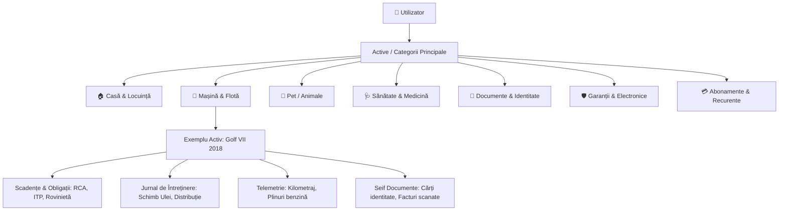
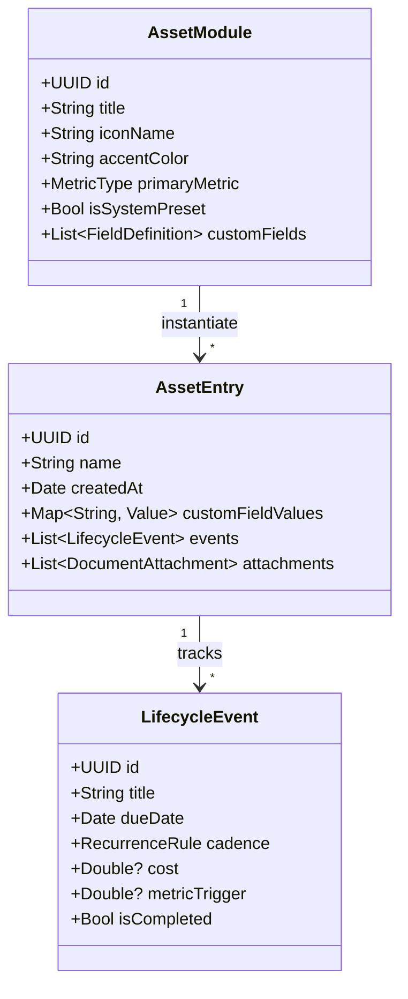
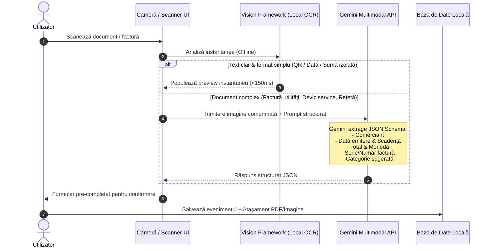

# 📁 Dosar cu Șină — Product Specification

> **Misiune**: Transformarea birocrației personale și a "treburilor casnice invizibile" dintr-o sursă constantă de fricțiune mentală într-o experiență digitală demnă de standardele Apple: discretă, fluidă, predictivă și impecabil structurată.

---

## 1. Viziunea Produsului & Problema Rezolvată

### 1.1 De ce eșuează un calendar generic?
Un calendar clasic (Google Calendar, Apple Calendar) este **orientat pe sloturi de timp**, nu pe **active (assets)**:
- **Lipsa contextului istoric**: Îți amintește că ai "Service la mașină pe 15 mai", dar nu știe câți kilometri aveai la revizia anterioară, ce tip de ulei s-a folosit sau cât te-a costat în total mașina anul trecut.
- **Lipsa relațiilor ierarhice**: Nu poți grupa evenimentele pe "Active" (Mașina X, Apartamentul Y, Cățelul Z) și nici asocia documente (polițe, garanții, bonuri fiscale) într-un mod consultabil la cerere.
- **Lipsa logicii de domeniu**: Calendarul nu știe că un ITP la mașini mai vechi de 12 ani se face anual, iar la cele noi la 2 sau 3 ani; nu știe că deparazitarea internă la câini este trimestrială sau că VTP-ul la centrala termică este obligatoriu la 2 ani.

### 1.2 Modelul Mental: *Asset-Centric Life Admin*
*Dosar cu Șină* inversează paradigma:
1. **Entitate / Activ (Asset)**: Un obiect fizic, un membru al familiei sau un spațiu pe care îl administrezi.
2. **Ciclu de Viață & Recurențe**: Reguli specifice domeniului (timp sau metrici: km, ore de funcționare).
3. **Evenimente & Jurnal**: Log-uri punctuale cu costuri, note, fotografii și documente atașate.
4. **Dosar Exportabil**: Posibilitatea de a extrage oricând un PDF complet (ex: istoricul mașinii pentru revânzare sau istoricul medical la medicul veterinar).



---

## 2. Categoriile Aplicației (Secțiuni de Bază + Extensii)

### 2.1 🏠 1. Casă & Locuință
*Focus: Siguranță tehnică, conformitate legală și mentenanță preventivă.*

| Componentă | Tip / Recurență uzuală | Câmpuri specifice | Atașamente tipice |
| :--- | :--- | :--- | :--- |
| **VTP Centrală Termică** | La 2 ani (obligatoriu ISCIR) | Tehnician/Firmă autorizată, Seria centralei, Notă constatări | Raport de verificare tehnică |
| **Verificare / Revizie Gaze** | Verificare: 2 ani / Revizie: 10 ani | Notă tehnică, Detector gaz funcțional (Da/Nu) | Proces verbal semnat |
| **Asigurări Locuință** | Anual | PAD (obligatoriu) vs Facultativă, Sumă asigurată, Franșiză | Polița PDF, Chitanță |
| **Impozit Local (Taxe)** | 31 Martie (bonificație) / 30 Sept | Cont rol fiscal, Sumă datorată | Dovadă plată Ghișeul.ro |
| **Filtre & Climatizare** | Sezonier (3-6 luni) | Tip filtru (dimensiuni/cod), Dată igienizare AC | Factură consumabile |
| **Curățare Coș Fum / Șemineu** | Anual (toamna) | Coșar autorizat, data inspecției | Adeverință coșerit |
| **Filtre Apă / Dedurizator** | 3 - 6 luni / pe bază de volum | Schimb sare, cartușe carbon/sedimente | — |
| **Contoare & Index** | Lunar (ziua 20-25) | Apă caldă/rece, Gaz, Curent, Serie contor | Poză index pentru siguranță |

---

### 2.2 🚗 2. Mașină & Mobilitate
*Focus: Legalitate rutieră, siguranță la drum, telemetrie și controlul costului total de deținere (TCO).*

| Componentă | Tip / Condiție | Câmpuri specifice | Alertă inteligentă |
| :--- | :--- | :--- | :--- |
| **ITP (Inspecție Tehnică)** | 1 an (>12 ani) / 2 ani / 3 ani (nouă) | Stație ITP, Kilometraj la testare | -30 zile, -7 zile, -1 zi |
| **RCA & CASCO** | 1, 6 sau 12 luni | Asigurător, Decontare directă, Clasă Bonus-Malus | -30 zile (pentru ofertare) |
| **Rovinietă Națională** | 1 zi / 10 zile / 30 zile / 60 zile / 12 luni (Legea 226/2023) | Serie șasiu (VIN), Categorie vehicul, Normă poluare (Non-Euro..Euro 6, EV) | Expirare la oră fixă; Peaj Pod Fetești eliminat complet |
| **Revizie Periodică** | 1 an SAU 10.000–15.000 km | Ulei, filtru aer/ulei/polen/motorină, Lichid frână | Se declanșează la timp sau km |
| **Schimb Anvelope** | Sezonier (Noiembrie / Aprilie) | Adâncime profil (mm), Loc depozitare (hotel roți) | Temperatură sub 7°C (sugestie) |
| **Jurnal Kilometraj & Plin** | Eveniment | Odometru curent, Litri/kWh, Preț/unitate, Locație | Calculează automat consum/100km |
| **Trusă Medicală & Stingător** | 2 - 5 ani (termen omologare) | Data expirării de pe ambalaj | Evită amenzi de circulație |

---

### 2.3 🐾 3. Pet / Animale de Companie
*Focus: Sănătate preventivă, confort veterinar și documente internaționale de călătorie.*

| Componentă | Tip / Recurență | Câmpuri specifice | Notițe / Context |
| :--- | :--- | :--- | :--- |
| **Deparazitare Internă** | Trimestrial (la 3 luni) | Greutate curentă (dozaj pastilă), Nume produs | Esențial înainte de vaccinare |
| **Deparazitare Externă** | Lunar (pipetă) sau la 6-8 luni (zgură) | Tip paraziți vizați (căpușe, purici, flebotomi) | Alertă de reaplicare |
| **Vaccin Anual Polivalent** | Anual (DHPPi/Lepto/Tricat) | Serie lot vaccin, Ștampilă veterinar | Istoric în carnetul de sănătate |
| **Vaccin Antirabic** | Anual (obligatoriu legal) | Număr pașaport/carnet, Microcip (15 cifre) | Necesar la trecerea frontierei |
| **Greutate & Dietă** | Lunar / Trimestrial | Grafic evoluție greutate (kg), Porție zilnică (g) | Monitorizare obezitate/slăbire |
| **Toaletaj (Grooming)** | 4 - 8 săptămâni | Tăiere unghii, Golire glande, Curățare urechi | Contact salon / Notă comportament |

---

### 2.4 🩺 4. Sănătate Personală & Medicină Preventivă *(Extins)*
*Focus: „Mentenanța propriului corp” — transformarea analizelor și a prevenției dintr-o reacție la boală într-un plan proactiv organizat.*

| Sub-domeniu | Tip / Recurență | Câmpuri specifice & Parametri | Documente / Atașamente |
| :--- | :--- | :--- | :--- |
| **Screening & Analize Anuale** | Anual (sau la recomandarea medicului) | Set uzual (hemogramă, profil lipidic, glicemie, funcție renală/hepatică, TSH) | Buletin de analize PDF (OCR extrage valori anormale cu `*`) |
| **Stomatologie & Profilaxie** | La 6 luni | Igienizare profesională, detartraj, control carii, medic curant | Radiografie panoramică (OPG) |
| **Dermatoscopie (Harta Alunițelor)** | Anual (pre/post sezon estival) | Număr leziuni suspecte monitorizate, fotografii macro comparative | Raport dermatoscopic |
| **Oftalmologie / Optometrie** | La 1 - 2 ani | Dioptrii (OD/OS), cilindru, axă, tensiune intraoculară | Rețetă ochelari/lentile |
| **Cardiologie & Screening Vârstă** | 1 - 2 ani (>40 ani) | EKG de repaus, ecocardiografie, tensiune arterială medie | Traseu EKG, Raport eco |
| **Screening Oncologic Specific** | Periodic conform ghidurilor | Femei: Babeș-Papanicolau/HPV (1-3 ani), Ecografie/Mamografie (1-2 ani). Bărbați: PSA (>45-50 ani). General: Colonoscopie (la 5-10 ani >45 ani). | Rezultate biopsie / imagistică |
| **Carnet Vaccinuri Adult** | 10 ani / Anual | **Antitetanos (DT)** (rapel esențial la fiecare 10 ani!), Gripal sezonier (anual), Hepatită B, etc. | Adeverință vaccinare |
| **Intervenții & „Pașaport Medical”** | Eveniment / Permanent | Tip intervenție, Medic chirurg, Clinică, **Pașaport implant** (lot, serie șurub stomatologic/proteză) | Scrisoare medicală, Bilet externare |
| **Tratamente & Rețete Cronice** | Lunar / Trimestrial | Denumire DCI, Dozaj (mg/zi), Alertă expirare rețetă compensată | Rețetă electronică scanată |

---

### 2.5 🪪 5. Documente Personale & Identitate
*Focus: Alertare timpurie pentru a evita blocaje birocratice și cozi.*

- **Carte de Identitate (Buletin)**: Alertă cu 3–6 luni înainte (programările la evidența populației durează adesea săptămâni).
- **Acte citite cu camera**: tot ce se citește (CNP, data nașterii, sex, cetățenie, serie și număr, emitent, date) se arată la verificare, se păstrează pe act și apare pe pagina documentului cu „Copiază”, pentru completat formulare. Secțiunea Acte e protejată cu Face ID; aceste valori nu intră în căutare, widget-uri, notificări sau numele fișierelor exportate. Actul se numește „Carte de identitate – Manole Corina Ioana” (numele de familie primul, ca pe act) și se pune la persoana din familie care se potrivește (fără majuscule și diacritice, în orice ordine a numelor), altfel la o persoană nouă cu numele titularului. Dacă buletinul a fost citit doar din față, verificarea propune și poza cu spatele, iar datele se recitesc împreună, păstrând ce a corectat omul.
- **Pașaport**: Valabilitate 5 sau 10 ani. *Alertă inteligentă*: atenționează dacă pașaportul are sub 6 luni de valabilitate rămasă (majoritatea țărilor non-UE refuză intrarea în aceste condiții).
- **Permis de Conducere**: Scadență la 10 ani (cu reminder pentru programare fișă medicală).
- **Carduri Bancare**: Lună/An expirare pe cardurile de debit/credit (reminder pentru primirea noului card).
- **Semnătură Electronică Calificată**: Reînnoire certificat digital (token CertSign, DigiSign etc. la 1, 2 sau 3 ani).
- **Cazier Judiciar / Certificate Fiscale**: Documente cu valabilitate scurtă (30–180 zile).

---

### 2.6 🛡️ 6. Garanții & Bunuri Electrocasnice *(Secțiune Propusă)*
*Focus: Protecția investițiilor, eliminarea dosarului de hârtie cu bonuri termice șterse.*

- **Stocare Bon Fiscal + Certificat**: Bonurile termice se estompează în 6–12 luni; scanarea digitală securizează dreptul la garanție.
- **Calculatoare & Telefoane**: AppleCare / Garanție producător (1 sau 2 ani).
- **Electrocasnice Mari (Frigider, Mașină de spălat, TV)**: Garanție extinsă la înregistrarea produsului (ex: 5 ani garanție promoțională).
- **"Alertă Ultima Șansă"**: Cu 30 de zile înainte de expirarea garanției de 2 ani, utilizatorul primește o notificare: *"Verifică dispozitivul — mai ai o lună de garanție activă pentru eventuale reparații gratuite."*
- **Manual de Utilizare**: Câmp pentru link descărcare manual PDF sau atașament direct.

---

### 2.7 💳 7. Abonamente & Perioade de Testare (Trials) *(Secțiune Propusă)*
*Focus: Stoparea "taxelor pe uitare".*

- **Perioade de Free Trial**: Alertă cu 48 de ore înainte de conversia într-un abonament plătit (sală, servicii streaming, unelte software).
- **Abonamente Anuale**: Notificare cu 14 zile înainte de debitarea automată pentru a decide dacă merită păstrat.
- **Cost Lunar Consolidat**: Calcul total agregat: "Plătești 340 lei/lună pe abonamente digitale".

---

### 2.8 🧩 8. Motorul de Module Personalizate (Custom Modules Engine)
*Focus: Libertate totală de configurare fără senzația de spreadsheet complicat.*

Fiecare utilizator are pasiuni și active unice: o bicicletă de șosea, o barcă cu motor, plante exotice, un espressor manual de cafea sau un apartament dat în chirie. În loc să aglomerăm aplicația cu zeci de categorii de nișă fixe, *Dosar cu Șină* include un **arhitect de module personalizate** (cu ergonomie specifică Apple).



#### 2.8.1 Tipuri de Câmpuri Componibile (Field Types)
Când utilizatorul creează un modul propriu (ex: *„Ambarcațiune”* sau *„Bicicletă”*), poate asocia:
1. **Recurență Calendaristică**: Zile, Săptămâni, Luni, Ani (cu alertă inteligentă înainte de termen).
2. **Declanșator pe Bază de Metrice (Unit Triggers)**:
   - *Kilometri* (ex: Schimb lanț bicicletă la fiecare 2.000 km).
   - *Ore de funcționare* (ex: Service furcă suspensie la 50 de ore; Schimb ulei cizmă motor barcă la 100 de ore).
   - *Contor de cicluri* (ex: Decalcifiere espressor la fiecare 250 de cești preparate).
3. **Câmpuri Monetare (Financial / Cost Tracker)**: Cu selectare automată a monedei (RON, EUR, USD) pentru includerea în graficele TCO.
4. **Seif Atașamente (Document / Foto / Bon)**: Câmp dedicat pentru fotografii ale etichetelor tehnice, facturi sau PDF-uri.
5. **Contact Asociat**: Legătură directă cu un contact din agendă (Mecanic, Medic, Tehnician, Chiriaș).

#### 2.8.2 Galeria de Șabloane Predefinite (Starter Templates)
Pentru a elimina teama de „pagină albă” (blank slate), utilizatorul poate alege din șabloane comunitare gata configurate cu 1 tap:
* 🚴 **Bicicletă / E-Bike**: Ungere lanț (la 150 km), Verificare plăcuțe (la 1.000 km), Înlocuire lanț (la 2.000 km), Service furcă (la 50h/100h).
* 🪴 **Plante & Grădină**: Udare periodică, Fertilizare fazială sezonieră (primăvară/toamnă), Tăiere de formare, Schimbare ghiveci/substrat (la 2 ani).
* 🏢 **Proprietăți Închiriate (Landlord Hub)**: Scadență plată chirie, Reînnoire contract ANAF, Verificare apometre chiriaș, Restituire/decont garanție.
* ☕ **Cafea de Specialitate & Echipamente**: Decalcifiere periodică, Curățare chimică grup (Cafiza), Înlocuire filtru apă/rășină dedurizatoare.
* 📸 **Echipament Foto / Video**: Curățare senzor, Verificare calibrare obiective, Asigurare echipament profesional.

---

### 2.9 Cele 4 Coloane Universale ale Fiecărui Domeniu (The 4 Universal Pillars)

Fiecare dintre cele 8 domenii de bază și module personalizate respectă uniform o arhitectură pe 4 piloni fundamentali:

1. **Pilonul 1: Identitate & Specificații Personalizate (Tailored Identity & Specs Schema)**:
   - Metadata de domeniu puternic tipizate (ex. VIN, cilindree, serie centrală, microcip ISO 15 cifre, grupă sanguină, IMEI, furnizor abonamente).
   - Suport nelimitat pentru câmpuri dinamice definite de utilizator (`DynamicField`) acoperind 10 tipuri: text, număr, valută, dată, boolean, selecție simplă, selecție multiplă, URL, telefon, text lung.
   - Legătură directă cu specialiști din agendă prin `ContactsUI` (mecanic, instalator, medic de familie, veterinar, chiriaș) cu bară de acțiuni rapide (apel telefonic, WhatsApp, e-mail) direct din fișa activului.

2. **Pilonul 2: Motorul de Scadențe & Obligații (Obligations & Deadlines Engine)**:
   - Urmărire riguroasă a evenimentelor de ciclu de viață (`LifecycleEvent`) recurente și punctuale, cu selecție asistată din catalogul de furnizori românești autorizați.
   - Calcul automat al cadenței (pe bază de zile calendaristice sau intervale kilometrice/orare) și alerte inteligente Time-Sensitive la praguri critice (-30d, -14d, -7d, -1d, 0d).
   - Rollover automat la confirmare („Am rezolvat”) prin acțiuni interactive direct din banner-ul de notificare pe ecranul de blocare, generând instantaneu următorul ciclu.
   - Sincronizare bidirecțională nativă cu Apple Calendar (`EKEvent`) și Apple Reminders (`EKReminder`) prin `EventKit`.

3. **Pilonul 3: Jurnale Istorice Duble (Dual Historical Ledgers)**:
   - **Jurnal de Intervenții Discrete (`ServiceItem`)**: Înregistrarea intervențiilor de mentenanță și a reparațiilor (piese înlocuite, manoperă, costuri, kilometraj, garanție piese, specialist). Calculează automat variațiile între intervenții consecutive: $\Delta\text{cost}$, $\Delta\text{km}$, $\Delta\text{zile}$.
   - **Jurnal de Telemetrie Cantitativă (`MeasurementLog`)**: Înregistrarea seriilor de timp cantitative: indici contoare utilități (apă rece, apă caldă, gaze naturale, energie electrică) cu cost estimat și curbe sezoniere, biomarkeri medicali (glicemie, colesterol LDL/HDL, tensiune) cu marcare automată a valorilor ieșite din intervalul de referință al laboratorului (`* H` / `* L`), greutate corporală animale de companie și jurnale de odometru.

4. **Pilonul 4: Seif Structurat de Documente (Structured Document Vault)**:
   - Pipeline universal de ingestie multi-sursă (scanare cameră live VisionKit, import fișiere PDF, selector galerie foto, lipire text/SMS, introducere manuală).
   - Stocare criptată locală a fișierelor binare asociate activului sau evenimentului, cu vizualizator nativ integrat (`QuickLook` / `PDFKit`).
   - Generare de dosar administrativ consolidat cu tabel de cuprins oficial (*Opis Documente*) și trimiteri numerotate la anexe (`PDFDossierGenerator`).

---

## 3. Sistemul Inteligent de Scanare (Two-Tier Hybrid OCR)

Abordarea propusă este **Dual-Tier**, îmbinând viteza și confidențialitatea scanării locale cu puterea de raționament a inteligenței artificiale multimodale.



### 3.1 Nivelul 1: Scanare On-Device (Apple Vision / MLKit)
- **Ce face**: Rulează 100% offline, fără conexiune la internet, cu latență infimă.
- **Detectare automată a marginilor**: Decupare perspectivă automată, corecție unghi, conversie alb-negru/document scanat.
- **Detecție de modele regex**:
  - Date calendaristice (formate românești: `DD.MM.YYYY`, `DD/MM/YYYY`, `DD luna YYYY`).
  - Coduri QR de plată (standardizate conform formatelor bancare/Ghișeul).
  - Sume monetare (căutare după cuvinte cheie: "Total", "De plată", "Rest de plată", "RON", "LEI").
- **Citire pe coloane (`TextLayout`, `LabelledLayout`)**: fiecare rând recunoscut își păstrează poziția pe pagină. Fragmentele apropiate de pe același rând devin o linie („03” „07” „1983” → „03 07 1983”; pragul e relativ la înălțimea textului). Valoarea unei etichete e restul liniei, alăturatul din dreapta pe același rând sau cel mai apropiat rând de dedesubt din aceeași coloană, înaintea următoarei etichete; traducerea etichetei („Nume” / „Surname”) e sărită, iar rândurile de valoare strânse în coloană se unesc („CORINA” + „IOANA”). Fără poziții (text lipit, PDF cu text) se citește rândul următor. Textul arătat sub „Textul citit din document” urmează aceeași așezare: eticheta, apoi valoarea ei.
- **Șabloane de acte de identitate (`IdentityTemplates`)**: buletinul electronic (CEI, față și verso cu MRZ TD1), buletinul vechi (TD2, „SERIA XX NR …”, valabilitate ca interval), pașaportul (TD3) și permisul UE (câmpuri numerotate; 4d e CNP-ul doar cu cifră de control validă). Fiecare șablon descrie cum se recunoaște actul, etichetele și formatul fiecărui câmp, regiunea opțională de pe card și regulile de vârstă. Un act nou înseamnă un șablon nou, nu cod nou. Cardul de sănătate nu e inclus: câmpurile lui tipărite nu au putut fi confirmate pe un specimen oficial.
- **Încredere din verificări (`CaptureConsistency`)**: după toate nivelurile, datele se verifică între ele (data nașterii nu e niciodată data emiterii sau a expirării; emiterea nu e în viitor și, la buletin și permis, nu e înainte de 14 ani; expirarea e după emitere și după naștere). Ordinea de încredere: MRZ cu cifre de control valide, CNP valid (și data nașterii și sexul din el), eticheta citită la locul ei, modelul de pe telefon, Gemini. În verificare, „Verifică” apare doar la valorile care au picat un format sau o verificare, ori pe care le-a citit doar un model.

### 3.2 Nivelul 2: Semantic Sweep prin Gemini Flash
- **Când se activează**: La cererea utilizatorului (buton dedicat "Analizează cu AI") sau automat pe facturi complexe cu mai multe pagini.
- **Format ieșire (Structured JSON Schema)**:
```json
{
  "merchant": "ENGIE Romania S.A.",
  "document_type": "utility_invoice",
  "category_suggestion": "casa_energie_gaz",
  "issue_date": "2026-10-15",
  "due_date": "2026-11-14",
  "total_amount": 348.50,
  "currency": "RON",
  "invoice_number": "1049281928",
  "extracted_notes": "Index autocitit vechi: 1420 mc, Index nou: 1495 mc",
  "actionable_reminder_date": "2026-11-10"
}
```
- **Confidențialitate & Securitate**: Nu se stochează datele pe servere externe; procesarea se face efemer prin API cu cheie proprie direct către Google.

---

### 3.3 Intake Universal Multi-Sursă (Digital & Fizic)
Aplicația depășește scanarea clasică de hârtie printr-un modul integrat de ingestie omni-canal (`MultiSourceInputView`):
1. **Fișiere Digitale PDF (`PDFKit`)**:
   - Extragere directă din fluxul digital al PDF-urilor primite pe E-mail, WhatsApp sau descărcate din portalurile de utilități (Digi, Hidroelectrica, Engie, Enel, Allianz, Groupama).
   - Textul nativ din PDF este extras fără zgomot optic, oferind 100% precizie la detecția sumei de plată, a scadenței și a codului de factură.
2. **Fotografii & Capturi de Ecran (`PhotosPicker`)**:
   - Capturi de ecran din aplicații de Mobile Banking sau poze din galeria foto, procesate on-device prin Apple Vision OCR.
3. **Scanare Live Hârtie (`VNDocumentCameraViewController`)**:
   - Detecție automată a colțurilor paginii, corecție de perspectivă și filtrare alb-negru/color.
4. **Text Copiat din E-mail / SMS**:
   - Textarea directă unde utilizatorul poate lipi corpul unui e-mail sau al unei notificări SMS, parsate instantaneu prin `RomanianUtilityParser`.
5. **Introducere Directă Manuală**:
   - Formular rapid cu selector de activ, furnizor, număr document, scadență și cost.

#### 3.3.1 Trimis din altă aplicație, widget-uri și App Group
- **App Group** `group.com.ar.dosarcusina.shared`, folosit de aplicație, widget-uri și extensia de partajare doar pentru fișiere mici de predare. Baza de date rămâne în containerul aplicației.
- **Extensia de partajare (`DosarCuSinaShare`)**: apare în meniul „Trimite” din Mail, WhatsApp, Poze și Fișiere pentru poze, PDF-uri și text. Copiază ce primește în `Inbox/<id>/` (fișiere plus `manifest.json`, protecție completă) și confirmă calm. Nu deschide baza de date și nu citește documentul. Pozele trimise împreună sunt paginile aceluiași act; fiecare PDF e separat.
- **De verificat**: aplicația citește inboxul când revine în prim-plan și imediat ce extensia semnalează (notificare Darwin). Un element trece prin același flux de citire și verificare ca o poză făcută în aplicație și se șterge din inbox după ce e salvat sau refuzat.
- **Exercițiul de partajare**: în onboarding și din cardul din Adaugă, o factură de probă (date fictive, „Service Exemplu SRL”, B 123 ABC) se trimite prin meniul real „Trimite” și ajunge prin extensia reală în De verificat, marcată „Exercițiu”.
- **Widget-uri (`DosarCuSinaWidgets`)**: Home (mic, mediu) și Lock Screen (inline, dreptunghiular), din `widget-snapshot.json` scris de `SideEffectsCoordinator`. Exemplele nu apar; secțiunile protejate au titlu generic și nu au „Gata”. „Gata” rulează `CompleteFromWidgetIntent`: din iOS 27 în aplicație, prin `ObligationActions`; pe iOS 26, extensia lasă cererea în `widget-completions.json`, widget-ul ascunde elementul imediat, iar aplicația o aplică la următoarea deschidere, doar dacă obligația e încă pe același termen.

---

### 3.4 Schemă de Date Personalizată pe Categorii & Monitorizare Componente

#### 1. Atribute de Domeniu per Categorie de Activ (`Asset` / `AssetEntity`)
Fiecare clasă de active dispune de parametri dedicați, eliminând limitările formularelor generice:
- **Vehicule (`.vehicle`)**: Număr înmatriculare, Serie șasiu (VIN 17 caractere), An fabricație, Combustibil (Benzină, Motorină, Hibrid, PHEV, Electric, GPL), Cilindree ($cm^3$), Putere (CP), Odometru (km).
- **Locuință & Imobile (`.home`)**: Adresă completă, Suprafață utilă ($m^2$), An construcție, Marcă/Model centrală termică, Serie fabricație centrală, Serii contoare (Gaze, Curent, Apă).
- **Animale de Companie (`.pet`)**: Specie, Rasă, Număr microcip ISO (15 cifre), Dată naștere, Nume clinică veterinară, Telefon medic veterinar.
- **Sănătate & Profil Medical (`.health`)**: Grupă sanguină & Rh, Medic de familie & telefon, Contact de urgență (ICE) & telefon, Alergii & boli cronice.
- **Atribute Dinamice Nelimitate (`DynamicField`)**: Posibilitatea de a adăuga oricâte câmpuri personalizate de tip Text, Număr, Dată, Boolean sau Valută pe oricare activ.

#### 2. Monitorizare Granulară Piese de Schimb & Service (`ServiceItem`)
La efectuarea unei revizii sau intervenții de service, utilizatorul poate detalia componentele schimbate individual (plăcuțe de frână, filtre, ulei, curea de distribuție):
- Înregistrare: `componentName`, `category`, `partBrandOrCode`, `partSerialNumber`, `cost`, `mileageAtService`, `serviceDate`.
- **Analiză Comparativă Automată**:
  - Compară ultima înlocuire cu precedenta: calcul automat al $\Delta\text{km}$ parcurși între schimburi, diferența de cost ($\Delta\text{RON}$), timpul scurs ($\Delta\text{zile}$) și brandul piesei folosite.

#### 3. Catalog Asigurători & Obligații Românești (`RomanianInsuranceCatalog`)
- Asigurători autorizați: Allianz-Țiriac, Groupama, Omniasig, Generali, Asirom, Grawe, Axeria, Hellas Direct, Eurolife, PAID România.
- Tipuri de acoperire: RCA, RCA cu Decontare Directă, CASCO Complet, CASCO Economic, PAD Obligatoriu, Facultativă Locuință.
- Clase Bonus-Malus: B0–B8, M1–M8.

---

### 3.5 Modelul de Distribuție & BYOK (App Store Review Compliant)
Aplicația este proiectată să fie publicată **100% Free** în App Store, respectând riguros *Apple App Store Review Guidelines (Guideline 2.1 - App Completeness & Guideline 3.1.1)*:
1. **Valoare Core Completă (Fără Cheie API)**:
   - Aplicația **nu este o carcasă goală**. Utilizatorul fără cheie API are acces nelimitat la gestionarea activelor, calendarul scadențelor, notificările locale, widget-urile de ecran, graficele TCO și **scanarea locală de documente prin Apple Vision**.
2. **Deblocare AI prin BYOK (Bring Your Own Key)**:
   - Oricine dorește scanare avansată și clasificare semantică a facturilor complexe își poate adăuga o cheie gratuită Gemini (obținută cu 1 tap de pe Google AI Studio).
   - Cheia este stocată exclusiv pe dispozitiv în **iOS Keychain** criptat.
3. **Sustenabilitate & Cost 0$ pentru Dezvoltator**:
   - Zero servere de administrat, zero facturi lunare de cloud, zero baze de date vulnerabile. Scalare instantanee la orice volum de utilizatori.

---

### 3.6 Arhitectura de Securitate Biometrică — Model B: Just-in-Time Unlock (`BiometricVaultManager`)
Conform cerințelor de excelență și ergonomie Apple, aplicația adoptă **Modelul B de securitate biometrică (Just-in-Time)**:
1. **Zero Fricțiune la Lansare**:
   - Aplicația se deschide instantaneu, fără barieră biometrică la pornire, permițând accesul rapid la activitățile cotidiene: verificarea kilometrajului mașinii, notarea unui index de contor sau consultarea notificărilor apropiate.
2. **Deblocare Biometrică Just-in-Time**:
   - Provocarea biometrică (Face ID, Touch ID, Optic ID sau codul dispozitivului prin `LocalAuthentication`) se declanșează strict în momentul în care utilizatorul accesează un seif cu caracter privat sau confidențial:
     - 🪪 **Documente & Identitate (`.documents`)**: Cărți de identitate, pașapoarte, permise, certificate.
     - 🩺 **Sănătate & Card Medical (`.health`)**: Profil medical de urgență, analize de laborator, antecedente, rețete.
     - 🔒 **Active Personalizate Sensibile**: Orice activ din categoriile custom marcat explicit drept sensibil de către utilizator.
3. **Păstrarea Stării de Deblocare & Auto-Lock**:
   - Odată autorizat, accesul rămâne deschis pentru categoria respectivă pe durata sesiunii de lucru curente.
   - **Re-blocare automată**: Seiful se blochează automat după 5 minute de inactivitate continuă sau imediat ce aplicația trece în fundal (`scenePhase == .background`).
4. **Afișare Directă în Memorie a Datelor Sensibile**:
   - După deblocarea biometrică a seifului, numerele de identificare (CNP, serie și număr buletin, IBAN complet) sunt afișate direct în clar, eliminând necesitatea enervantă a unui tap separat pentru dezvăluirea fiecărui câmp individual. Când seiful este blocat, cifrele din mijloc sunt mascate discret (ex. `188••••••1234`).

---

### 3.7 Pachetul de Arhivă Deschisă Cross-Platform (`.dosar` / `.zip`)
Pentru a garanta portabilitatea deplină a datelor utilizatorului și a preveni blocarea într-un singur ecosistem (vendor lock-in), *Dosar cu Șină* implementează un format de pachet deschis, standardizat și interoperabil între iOS (SwiftData) și Android (Room SQLite):

1. **Format & Identificator Uniform de Tip (UTType)**:
   - Identificator înregistrat: `com.ar.dosarcusina.dossier`
   - Extensie de fișier: `.dosar`

---

### 3.8 Ecranul Principal Modular pe Active & Arhitectura UX Scalabilă

#### 1. Shell-ul: patru taburi (`AppShell`, `ShellRouter`)
- **Taburi etichetate (stil iOS 26)**: *Dosar*, *Urmează*, *Adaugă*, *Caută* (rol de căutare). Fiecare tab are propriul `NavigationStack`, deținut de shell, cu toate `AppRoute` înregistrate ca destinații; ecranele împing cu `NavigationLink(value: AppRoute…)`.
- **O singură rută**: notificările, widgeturile, linkurile `dosarcusina://` și rezultatele căutării trec prin `ShellRouting.plan(for:)` (tab + ecrane + foaie). Setările, „Am fost la service” și „Adaugă o secțiune” sunt foi prezentate de shell.
- **Prima pornire**: `OnboardingFlow` apare o singură dată (`AppPreferences.hasCompletedOnboarding`). Blocarea aplicației acoperă totul cu un ecran calm „Deblochează”; secțiunile protejate se deschid separat.

#### 2. Dosarul: grila de cutii (`DosarHomeView`, `BinderLayout`)
- **O cutie pentru fiecare lucru de top** (mașina, casa, PawPaw), plus *Acte*, *Garanții*, *Abonamente* și *Agendă*. Chiriașii, produsele dintr-o casă și actele unei persoane stau în părintele lor. Ordinea implicită urmează `homeOrder` și vizibilitatea categoriilor.
- **Conținutul cutiei**: poza sau simbolul categoriei, numele mare și un singur rând de stare din `BoxStatus` („Totul e în regulă”, „RCA · în 5 zile”), cu icon și culoare semantică (niciodată doar culoare).
- **Deschidere**: cutia se deschide cu tranziția *zoom* a sistemului; înapoi revine în cutie.
- **Reordonare**: apăsare lungă și tragere; ordinea se păstrează pe dispozitiv (`BinderLayoutStore`), iar cutiile noi se așază lângă vecinii lor. La VoiceOver și în meniul contextual: „Mută mai în față / în spate”.
- **Grila**: 2 coloane pe iPhone, adaptivă pe iPad, o coloană la textele mari de accesibilitate. Ultima cutie, punctată, este „Adaugă o secțiune”.
- **Prima pornire goală**: ecran dedicat cu „Adaugă primul lucru” și „Încarcă exemple”; exemplele poartă eticheta „Exemplu” și se șterg din Setări.

#### 2b. Pagina unei secțiuni (`SectionScreen`)
- Un singur scroll vertical: erou după `heroStyle` (mașină: plăcuță, marcă/model/an, kilometraj; casă: adresă; animal: poză, vârstă, greutate; acte/persoană: numele și următorul act care expiră), apoi buzunarele șablonului în ordinea globală `SectionPocket`: Urmează, Chiriași, Produse, Abonamente, Acte, Istoric („ultima dată” pe piesă, din `MaintenanceLog`), Oameni, Bani, Date importante.
- Editarea folosește controalele DesignSystem cu `.dsDiscardGuard`; ștergerea întreabă ce se întâmplă cu ce e în secțiune (`AssetActions.delete(_:children:)`).
- Secțiunile protejate arată o stare calmă „Deblochează”; o deblocare ratată sau anulată închide doar secțiunea respectivă.
- „Adaugă o secțiune” oferă secțiuni gata făcute și „Altceva…” (nume, simbol, buzunare), apoi doar câmpurile esențiale, apoi termenele sugerate, fiecare cu amintirile spuse simplu („Te anunț cu 30 de zile înainte”).

#### 3. Cadrul Universal de Ștergere a Activelor (CRUD Parity)
Eliminarea blocajului de descoperire a ștergerii prin implementarea punctelor de acces standard Apple:
- Meniu contextual la apăsare lungă (`.contextMenu`) pe cardurile de active cu opțiunea explicită *Șterge Activul*.
- Meniu de depășire cu trei puncte (`...`) în bara de instrumente a vizualizării detaliate a activului (`AssetDetailView`).
- Secțiune distructivă dedicată în ecranul de editare a activului (`EditAssetSheet`).
- Buton de resetare a bazei de date în Setări: *Șterge Toate Activele (Bază Goală)* cu alertă dublă de confirmare.
- Ștergere în cascadă completă prin SwiftData și Room SQLite: ștergerea unui activ elimină instantaneu toate evenimentele, piesele de schimb, jurnalele de telemetrie și fișierele atașate, declanșând sincronizarea widget-urilor.

#### 4. Motorul de Formulare Zero-Friction & `QuickPickChips`
S-a eliminat frustrarea textelor pre-completate în câmpurile formularului (care forțau utilizatorul să șteargă manual caracterele):
- Câmpurile utilizează stări inițiale goale (`""`) acompaniate de sugestii discrete prin `prompt: Text(...)`.
- **Sugestii Instantanee cu 1 Tap (`QuickPickChips`)**: Sub câmpurile de text sunt afișate pastile orizontale cu opțiuni frecvente (mărci auto uzuale, comercianți românești, durate tipice de garanție, emitenți de acte, specii de animale), completând câmpul instantaneu la atingere fără tastare.

#### 5. Scalabilitatea Radarului & Sistemul de Anulare (Undo Framework)
Pentru a preveni "gaura neagră" a bifării accidentale a evenimentelor și aglomerarea listei când utilizatorul introduce zeci de active:
- **Selector de Orizont Temporal**:
  - *Focalizare (14z)*: Afișează strict obligațiile depășite, urgente și scadențele din următoarele 14 zile, păstrând ecranul aerisit și concentrat.
  - *Toate*: Afișează întreaga cronologie (Urgente, Următoarele 30 de zile, Planificate ulterior).
  - *Rezolvate*: Istoricul obligațiilor bifate, permițând debifarea lor oricând pentru reactivare imediată dacă au fost marcate din greșeală.
- **Snackbar de Anulare Plutitor (`UndoSnackbar`)**: La bifarea oricărui eveniment, un banner flotant elegant apare timp de 5 secunde, oferind butonul *Anulează* cu răspuns haptic pentru refacerea imediată a stării active și reprogramarea notificărilor.
   - Structură internă fizică: Arhivă ZIP standard (RFC 1951 / DEFLATE), inspectabilă cu orice utilitar de arhivare (ex. `unzip`, Finder).
2. **Structura Internă a Pachetului**:
   - `manifest.json`: Schema Version 2, metadata aplicație, timestamp export în format ISO 8601 UTC, identificator platformă (`iOS` sau `Android`), contor de entități și **hartă completă de integritate SHA-256** pentru fiecare fișier inclus.
   - `data/assets.json`: Toate activele din cele 8 domenii, atribute speciale (VIN, adrese, serii contoare, date medicale, microcipuri) și câmpuri dinamice relaționale.
   - `data/events.json`: Toate obligațiile și scadențele, cadențe, offset-uri memento, costuri, furnizori și starea de finalizare.
   - `data/service_history.json`: Istoricul intervențiilor de service, piese, manoperă, kilometraj și zile petrecute în service.
   - `data/measurements.json`: Jurnalele de telemetrie cantitativă (indici contoare utilități, biomarkeri cu intervale de referință, greutate, odometru).
   - `vault/`: Director dedicat fișierelor binare atașate (facturi PDF, poze buletin, chitanțe), denumite după UUID-ul atașamentului (`vault/<uuid>.<ext>`).
   - `opis.pdf`: Document PDF generat automat reprezentând tabelul oficial de cuprins (*Opis Documente*), gata de tipărit sau transmis autorităților.
3. **Validare de Integritate & Reziliență la Corupere**:
   - La import, motorul de arhivă (`DossierArchiveService` pe iOS, `DosarArchiveParser` pe Android) verifică amprenta SHA-256 a fiecărui fișier față de valoarea din `manifest.json`. Oricare modificare neautorizată sau corupere pe disc anulează importul înainte de alterarea bazei de date.
4. **Semantici de Import Bidirecțional**:
   - **Restaurare Curată (`CLEAN_RESTORE`)**: Șterge baza de date curentă și recreează identic starea din arhivă.
   - **Îmbinare Inteligentă (`MERGE`)**: Păstrează activele existente; pentru entitățile cu același UUID, versiunea mai recentă actualizează înregistrarea locală, iar noile active sunt inserate transparent.

---

## 4. Statistici, Rapoarte & "Financial Pulse"

Unul dintre marile diferențiatori față de un simplu to-do list este transformarea datelor introduse în **concluzii financiare și operaționale utile**:

1. **Radarul Scadențelor & Cash-Flow Forecast (30 / 60 / 90 de Zile)**:
   - Proiecție dinamică a angajamentelor de plată pe orizonturi temporale: 30 de zile (iminent), 60 de zile (termen mediu), 90 de zile (trimestrial).
   - Defalcare matematică precisă între:
     - **Cheltuieli Recurente Prevăzute**: Abonamente lunare/anuale, utilități estimate pe baza istoricului de consum.
     - **Cheltuieli Punctuale / Sezoniere**: Polițe RCA/CASCO, taxe locale, revizii ITP/ISCIR/VIG.
   - Elimină surprizele neplăcute de la final de lună și permite planificarea din timp a lichidităților.

2. **Cost of Ownership (TCO) pe Categorii & Active**:
   - *Mașină*: Cost total anual defalcat pe: Combustibil, Asigurări (RCA+CASCO), Taxe/Rovinietă, Întreținere/Service, Roți/Consumabile.
   - *Casă*: Cheltuieli lunare utilități (gaz, curent, apă, întreținere) cu grafic de variație iarnă vs. vară și costuri de mentenanță instalații.
   - *Sănătate & Familie*: Buget anual alocat screening-urilor, stomatologiei și tratamentelor.
   - *Pet*: Bugetul anual alocat sănătății, hranei și profilaxiei animalului de companie.

3. **Burn Rate Lunar pe Abonamente & Alerte Retenție**:
   - Sumar agregat instantaneu: *"Abonamentele tale însumează 385 RON/lună (4.620 RON/an)"*.
   - Avertizări timpurii la expirarea perioadelor contractuale minime (ex. contracte telecom 24 luni) pentru negocierea ofertelor de retenție înainte de trecerea la preț de listă.
   - Avertizări la 48h/24h înainte de conversia perioadelor de probă gratuite (Free Trials).

4. **Curbe Sezoniere de Consum Utilități (`MeasurementLog`)**:
   - Grafice interactive `Swift Charts` care corelează citirile lunare ale contoarelor (kWh, $m^3$, Gcal) cu prețul unitar, evidențiind vârfurile sezoniere (iarnă gaz vs. vară aer condiționat) și detectând anomalii de consum (posibile pierderi de apă).

5. **Indice de Bună Administrare ("Health Score")**:
   - Indicator vizual discret inspirat de inelele de activitate Apple:
     - 🟢 100%: Toate documentele sunt la zi, fără scadențe depășite.
     - 🟡 Atenție: O revizie sau o poliță expiră în următoarele 14 zile.
     - 🔴 Expirat: Ai un ITP, o asigurare sau o inspecție tehnică depășită.

---

## 5. Experiența de Utilizare & Standardul de Design Apple

Conform filosofiei de design premium, aplicația trebuie să fie o plăcere tactilă, nu o corvoadă administrativă:

### 5.1 Ierarhia Ecranelor
1. **Tab 1: Radar (Home)**
   - Header simplu, elegant: data curentă și statusul general (*"Totul este la zi"* sau *"3 termene în următoarele 30 de zile"*).
   - Carduri tactile pentru acțiuni imediate (ordonate după urgență, cu cod de culoare discret: albastru/gri pentru normal, galben cald pentru scadențe apropiate, roșu discret pentru urgențe).
   - Secțiune de acces rapid la scanare (buton mare, tactil de cameră).
2. **Tab 2: Active (The Vault)**
   - Grilă sau listă concentrică cu spațiile tale: 🏠 Apartament Floreasca, 🚗 VW Golf, 🐾 Toby.
   - Fiecare card afișează numărul de elemente monitorizate și data următoarei acțiuni.
3. **Tab 3: Finanțe & Statistici**
   - Grafice native construite cu Swift Charts (interactive, fluide la atingere).
   - Filtre rapide: *Ultimele 30 de zile*, *Anul curent*, *Per Activ*.
4. **Tab 4: Căutare & Dosar (Search & Export)**
   - Căutare universală instantanee (inclusiv în textul extras din facturile scanate).
   - Buton "Exportă Dosar PDF" (pentru mecanic, notar sau medic veterinar).

### 5.2 Micro-Interacțiuni & Detalii Rafinate
- **Geometrie Concentrică**: Raza colțurilor containerelor interioare respectă riguros formula $R_{\text{interior}} = R_{\text{exterior}} - \text{padding}$. Fără colțuri ascuțite în cadre rotunjite.
- **Fizică de Arc (Spring Physics)**: Foaia de detaliu (bottom sheet) se deschide cu o curbă naturală de amortizare; bifarea unei sarcini oferă un impuls haptic discret (`UIImpactFeedbackGenerator(style: .light)`).
- **Widgets pe Ecranul de Blocare și Home**:
  - Lock Screen Widget circular: *"ITP: 18 zile"*.
  - Widget interactiv pe Home Screen: poți amâna sau bifa direct o sarcină.
- **Privacy First (Local-First Architecture)**:
   - Datele stau pe dispozitiv în CoreData / SwiftData, sincronizate exclusiv prin contul iCloud privat al utilizatorului (CloudKit). Zero trackeri, zero analitice intruzive.

### 5.3 Gestiune Date Demonstrative & Resetare Sigură (Demo Seed Data)
Pentru a asigura o primă impresie impecabilă la instalare și a elimina frica de ecran gol:
- **Inițializare Automată la Prima Lansare**:
  - Gated prin `@AppStorage("didSeedInitialDemoData")`. Dacă baza de date este goală, aplicația pre-populează automat 8 active demonstrative realiste și conforme pe toate domeniile (Apartament Floreasca, VW Golf 7 2018, Câine Golden Retriever Max, Andrei Popescu - Profil Medical, Pașaport Electronic, Espressor De'Longhi, Internet Digi Fibră, Garsonieră Închiriată Titan).
  - Toate datele respectă strict politica Zero-Secrets & Zero-PII și Standardele Administrative Românești (fără taxă Fetești, Rovinietă validă, ITP 24 luni, VTP ISCIR, PAD 130 lei, implant dentar Straumann, apometre chiriaș).
- **Resetare & Reîncărcare din Setări**:
  - Ecranul `SettingsView` include o secțiune dedicată *„Gestiune Date Demonstrative”*.
  - Utilizatorul poate declanșa în orice moment ștergerea în cascadă a bazei de date și reîncărcarea curată a celor 8 exemple demonstrative, protejat printr-o alertă de confirmare distructivă și feedback haptic de succes (`UINotificationFeedbackGenerator`).

---

## 6. Standarde Administrative & Legale Românești (Ground Truth Legal)

Aplicația respectă cu strictețe legislația românească în vigoare, evitând implementarea de legi abrogate sau termene eronate:

### 6.1 Mobilitate & Regim Rutier
1. **Rovinietă Națională (Legea nr. 226/2023)**:
   - Durate oficiale pentru autoturisme ($\le 3.5\text{t}$): `1 zi`, `10 zile`, `30 zile`, `60 zile`, `12 luni` (vechile durate de 7 și 90 de zile au fost restructurate).
   - Tarife diferențiate după norma de poluare din talon: de la `Non-Euro` până la `Euro 6`, respectiv `Vehicul Electric`.
2. **Taxa de Pod (Peaj) Fetești–Cernavodă (A2) & Giurgeni–Vadu Oii (DN2A)**:
   - **ELIMINATĂ COMPLET** de la 1 octombrie 2026 prin Legea nr. 226/2023. Traversarea podurilor peste Dunăre este inclusă direct în Rovinietă și nu se mai plătește separat (fără cronometru ora 23:59 a zilei următoare, fără plată prin SMS la 8545).
3. **Inspecția Tehnică Periodică (ITP — RNTR 1 / OUG nr. 195/2002)**:
   - Autoturisme noi uz personal: prima inspecție la **3 ani**.
   - Autoturisme uz personal $\le 12$ ani vechime: la fiecare **2 ani**.
   - Autoturisme uz personal $> 12$ ani vechime: la fiecare **1 an** (anual).
   - Ridesharing (Uber, Bolt) / Taxi / Rent-a-car: la fiecare **6 luni**.
   - Efect juridic critic: la expirarea ITP, **înmatricularea vehiculului se suspendă automat de drept**.

### 6.2 Locuință, Utilități & Instalații Tehnice
1. **Instalații de Gaze Naturale (Ordinul ANRE nr. 179/2015)**:
   - **VIG (Verificarea Tehnică a Instalației de Gaze)**: obligatorie la maximum **2 ani** (etanșeitate conducte, robineți, detectoare automate gaz; executant autorizat ANRE).
   - **RIG (Revizia Tehnică a Instalației de Gaze)**: obligatorie la maximum **10 ani** (probă de rezistență la presiune a conductelor, demontare contor); în anul 10, RIG înlocuiește VIG-ul.
2. **Centrala Termică de Apartament (ISCIR Prescripția Tehnică PT A1)**:
   - **VTP (Verificarea Tehnică Periodică)**: obligatorie la maximum **2 ani** (analiză gaze arse, randament, supape de siguranță, tiraj coș; eliberare livret și proces-verbal autorizat ISCIR).
3. **Contoare de Apă / Apometre (Biroul Român de Metrologie Legală — BRML)**:
   - Apometre apă rece: valabilitate metrologică **7 ani**.
   - Apometre apă caldă: valabilitate metrologică **4 ani**.
4. **Certificat de Performanță Energetică — CPE (Legea nr. 372/2005)**:
   - Valabilitate: **10 ani** de la data emiterii.

### 6.3 Finanțe Publice, Taxe Locale & Acte Oficiale
1. **Impozite și Taxe Locale (Codul Fiscal — Legea nr. 227/2015)**:
   - Rata I & Bonificație: scadență la **31 martie** (bonificație de până la 10% pentru plata integrală).
   - Rata a II-a: scadență la **30 septembrie** (după această dată se aplică majorări de întârziere zilnice).
2. **Declarația Unică — Formularul 212 (ANAF)**:
   - Termen legal anual: **25 mai** (venituri din chirii, PFA/PFI, dividende, plafoane CASS).
3. **Pașapoarte & Călătorii Non-UE**:
   - Regula celor 6 luni: majoritatea statelor non-UE cer o valabilitate rămasă a pașaportului de minimum 6 luni de la intrare/ieșire; aplicația declanșează alertă preventivă la -180 de zile.
4. **Cardul European de Asigurări Sociale de Sănătate (CEASS)**:
   - Valabilitate: **2 ani (24 luni)** de la emitere.
5. **Garanția Legală de Conformitate a Bunurilor (OUG nr. 140/2021)**:
   - 2 ani pentru bunuri noi; timpul de nefuncționare din momentul predării în service până la restituire **prelungește termenul de garanție cu numărul exact de zile petrecute în reparație** (`daysInService`).

---

## 7. Arhitectura Tehnică & Paritate Multi-Platformă

Aplicația este proiectată ca un sistem decuplat pe două platforme native cu paritate completă a schemei de date:

### 7.1 Platforma iOS (Apple Native)
- **UI Framework**: SwiftUI (iOS 17+) bazat pe arhitectură reactivă `@Observable` și `@ModelContext`.
- **Persistență Locală**: SwiftData (`Asset`, `LifecycleEvent`, `ServiceItem`, `MeasurementLog`, `DynamicField`, `DocumentAttachment`) cu relații `.cascade`.
- **Securitate & Biometrie**: `LocalAuthentication` (Model B: Just-in-Time unlock pentru `.documents` și `.health`), `CryptoKit` (SHA-256 integrity maps), Keychain criptat pentru chei BYOK.
- **Integrare Sistem**:
  - `UserNotifications` cu nivel `.timeSensitive` și acțiuni interactive pe ecranul de blocare ("Am rezolvat" cu auto-rollover).
  - `EventKit` pentru sincronizare bidirecțională cu Apple Calendar și Apple Reminders.
  - `ContactsUI` pentru selectarea specialiștilor din agenda telefonului.
  - `WidgetKit` sincronizat prin App Group `group.com.ar.dosarcusina.shared`.
  - `PDFKit` și `QuickLook` pentru vizualizarea și generarea de dosare cu *Opis Documente*.
  - `Charts` pentru vizualizări interactive de cash-flow și curbe de telemetrie.

### 7.2 Platforma Android (Jetpack Compose & Room)
- **UI Framework**: Jetpack Compose cu componente Material 3 Expressive.
- **Persistență Locală**: Room SQLite Database (`DosarDatabase` v2) cu 1:1 schema parity:
  - `AssetEntity`, `LifecycleEventEntity`, `ServiceItemEntity`, `MeasurementLogEntity`, `AttachmentEntity`, `DynamicFieldEntity`.
  - Ștergere în cascadă garantată prin chei străine SQLite (`ON DELETE CASCADE`).
- **Scanare On-Device**: CameraX integrat cu Google ML Kit Latin Text Recognition offline (`CameraXTextScanner`).
- **Motor Arhivă Deschisă**: `DosarArchiveParser` nativ (folosind exclusiv `java.util.zip`, `java.security.MessageDigest`, `org.json`), capabil de inspectare, verificare SHA-256 și import cu modurile `MERGE` și `CLEAN_RESTORE`.

### 7.3 Politica Zero-Leak & Garanția Confidențialității
- **Zero Baze de Date Centrale**: Dezvoltatorul nu găzduiește servere de colectare a datelor. Datele aparțin 100% utilizatorului pe dispozitiv și în conturile sale personale de sincronizare (iCloud / Google Drive AppData).
- **Zero Secrete în Repository Public**: Nicio cheie API, credențial sau fișier privat nu este versionat; registrul de vulnerabilități interne este izolat în `private/` și blocat prin pre-commit hook.
